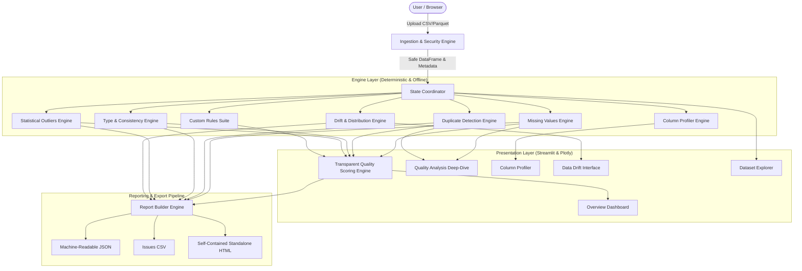

# DataSentinel Architecture & Technical Design

DataSentinel is an open-source, local-first dataset quality and observability platform engineered to detect data quality anomalies, structural defects, and distribution shifts before datasets enter analytics or machine learning pipelines.

## Architectural Principles

1. **Deterministic Local Processing:** Every metric, distribution, and anomaly score is computed locally using deterministic mathematical and statistical algorithms (NumPy, Pandas, SciPy). Zero cloud telemetry or external AI dependencies are required.
2. **Strict Dataset Immutability:** Raw uploaded datasets are strictly treated as read-only. Deduplication or cleaning generates separate exportable copies, preserving the audit trail.
3. **Decoupled Architecture:** The core analysis engines (`engine/`) operate independently of the presentation layer (`pages/`, `components/`), enabling headless execution and CLI integration.
4. **Transparent Scoring:** DataSentinel avoids black-box heuristics; every deduction point is documented in an audit log with severity, affected counts, and explicit penalty rationale.

---

## High-Level System Architecture

---

## Module Breakdown

### 1. Ingestion & File Safety (`datasentinel/engine/ingestion.py`, `datasentinel/utils/file_safety.py`)
- Sanitizes file paths to prevent directory traversal attacks.
- Enforces strict file size thresholds (default 100 MB).
- Validates file signatures and rejects dangerous binary executables (e.g. Windows PE `MZ`, Linux ELF).
- Employs multi-encoding fallback parsing (`utf-8`, `utf-8-sig`, `latin1`, `cp1252`).
- Detects and disambiguates duplicate column headers safely (e.g., `feature`, `feature_1`).

### 2. Missing-Value Engine (`datasentinel/engine/missing_values.py`)
- Measures missing values at cell, column, and dataset levels.
- Uncovers disguised/pseudo-null strings (`""`, `"   "`, `"null"`, `"N/A"`, `"--"`).
- Distinguishes between completely empty columns (Critical) and standard sparsity.

### 3. Duplicate Detection Engine (`datasentinel/engine/duplicates.py`)
- Identifies exact row duplicates across full record signatures.
- Supports subset-based duplicate analysis on user-specified key columns.
- Generates non-destructive deduplicated copies for explicit user download.

### 4. Type & Consistency Engine (`datasentinel/engine/type_checks.py`)
- Detects numbers stored as strings.
- Detects mixed Python types within single object columns.
- Flags zero-variance constant columns.
- Uncovers untrimmed leading/trailing whitespace.
- Identifies identical redundant columns.

### 5. Outlier Detection Engine (`datasentinel/engine/outliers.py`)
- Tukey's Interquartile Range (IQR) method: $[Q1 - 1.5 \times IQR, Q3 + 1.5 \times IQR]$.
- Z-score standard score method: $|(x - \mu)/\sigma| > \text{threshold}$.
- Emphasizes that outliers are statistical observations requiring domain verification.

### 6. Custom Validation Rule Suite (`datasentinel/engine/validation.py`)
- Evaluates user-defined domain constraints: Range, Non-negative, Not-null, Unique, Allowed Values, Regex.
- Safe evaluation without arbitrary code execution risk.

### 7. Drift & Distribution Shift Engine (`datasentinel/engine/drift.py`)
- Two-sample Kolmogorov-Smirnov test ($p$-value and KS statistic) for continuous variables.
- Population Stability Index (PSI) for numerical and categorical distribution shifts.
- Schema evolution tracking (added/dropped columns, missingness shifts).

### 8. Report Builder Engine (`datasentinel/engine/report_builder.py`)
- Compiles unified audit dictionaries.
- Generates machine-readable JSON payloads for CI/CD integration.
- Generates tabular CSVs of all findings and recommended remediations.
- Renders zero-dependency, self-contained standalone HTML audit reports with embedded styling.
